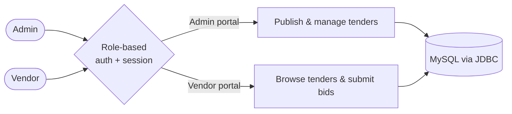

<!-- ============================================================
  BEFORE YOU PUSH: find & replace these placeholders
  1. YOUR_GITHUB_USERNAME  -> your GitHub username
  2. YOUR_LINKEDIN_URL     -> your LinkedIn link
  3. YOUR_LIVE_DEMO_URL    -> Tender Management System live demo
  4. YOUR_PROJECT_REPO_URL -> Tender Management System repo
  Palette ("Cyber Aurora"): #00F5A0 mint · #00D9F5 cyan · #7B2FF7 violet · #F107A3 magenta · #0D1117 midnight
============================================================ -->

<div align="center">


<a href="https://github.com/anushka-1807">
  
</a>

<br/>


<br/><br/>

<a href="#about"></a>
<a href="#tech-stack"></a>
<a href="#featured-project"></a>
<a href="#leetcode-live"></a>
<a href="#github-analytics"></a>
<a href="#contact"></a>

</div>


## About

```bash
anushka@dev:~$ whoami
> Anushka Singh | Java Developer | Full-Stack Engineer

anushka@dev:~$ cat profile.json
{
  "education": "B.Tech CSE @ SRMCEM, Lucknow (2023 - 2027)",
  "sgpa": "9.0 / 10",
  "strengths": ["Java", "Spring Boot", "React", "Node.js", "Firebase", "DSA"],
  "achievement": "Runner-up, GDG CodeRush AI Hackathon",
  "seeking": "Backend / Full-Stack internships & entry-level roles"
}

anushka@dev:~$ echo $MOTTO
> Write clean code. Solve hard problems. Ship things that work.
```

<table>
  <tr>
    <td width="33%" align="center">
      <h1>9.0</h1>
      <sub><b>SGPA / 10</b><br/>B.Tech CSE</sub>
    </td>
    <td width="33%" align="center">
      <h1>🥈</h1>
      <sub><b>Hackathon Runner-up</b><br/>GDG CodeRush AI</sub>
    </td>
    <td width="33%" align="center">
      <h1>15+</h1>
      <sub><b>CRUD Features</b><br/>Tender Management System</sub>
    </td>
  </tr>
</table>

<br/>

## Tech Stack

<div align="center">

<table>
  <tr>
    <td align="center" width="50%">
      <b>⌨️ Languages</b><br/><br/>
      
    </td>
    <td align="center" width="50%">
      <b>🎨 Frontend</b><br/><br/>
      
    </td>
  </tr>
  <tr>
    <td align="center">
      <b>⚙️ Backend & Runtime</b><br/><br/>
      <br/>
      <sub>REST APIs · JSP · Servlets · JDBC</sub>
    </td>
    <td align="center">
      <b>☁️ Databases & Cloud</b><br/><br/>
      <br/>
      <sub>Firestore · Firebase Auth</sub>
    </td>
  </tr>
  <tr>
    <td align="center">
      <b>🧰 Tools</b><br/><br/>
      <br/>
      <sub>Render · Apache Tomcat</sub>
    </td>
    <td align="center">
      <b>🧠 Core CS</b><br/><br/>
      <sub>
        <code>DSA</code> <code>OOPs</code> <code>DBMS</code><br/>
        <code>Computer Networks</code> <code>Operating Systems</code>
      </sub>
    </td>
  </tr>
</table>

</div>

<br/>

## Featured Project

<div align="center">

### 🏛️ Tender Management System
<sub>A centralized platform where administrators publish tenders and vendors bid online.</sub>

<br/><br/>


<br/><br/>

<a href="https://tender-management-system-production.up.railway.app/"></a>
<a href="https://github.com/anushka-1807/Tender-Management-System"></a>

</div>



- 🔐 **Role-based authentication** and session management for separate Admin and Vendor portals
- 🗄️ **15+ CRUD functionalities** built with JDBC and MySQL
- 📦 **Maven** for dependency management, deployed on **Apache Tomcat**
- 🧭 End-to-end flow: publish tenders online, collect vendor bids online

<br/>

## LeetCode Live

<div align="center">

<a href="https://leetcode.com/u/anushkasingh02/">
  <picture>
    <source media="(prefers-color-scheme: light)" srcset="https://leetcard.jacoblin.cool/anushkasingh02?theme=light&font=Karla&ext=heatmap&border=0&radius=16">
    
  </picture>
</a>

<sub>🔴 Live: fetched from LeetCode on every page load, not a static image.</sub>

</div>

<br/>

## GitHub Analytics

<div align="center">

<picture>
  <source media="(prefers-color-scheme: light)" srcset="https://github-readme-stats.vercel.app/api?username=YOUR_GITHUB_USERNAME&show_icons=true&theme=default&hide_border=true&title_color=7B2FF7&icon_color=00D9F5&border_radius=16&include_all_commits=true&count_private=true">
  
</picture>
<picture>
  <source media="(prefers-color-scheme: light)" srcset="https://github-readme-stats.vercel.app/api/top-langs/?username=anushka-1807&layout=donut-vertical&theme=default&hide_border=true&title_color=7B2FF7&border_radius=16">
  
</picture>

<br/>

<picture>
  <source media="(prefers-color-scheme: light)" srcset="https://streak-stats.demolab.com?user=anushka-1807&theme=default&hide_border=true&ring=7B2FF7&fire=F107A3&currStreakLabel=7B2FF7&border_radius=16">
  
</picture>

<br/><br/>


<br/>

<!-- Contribution snake: needs the GitHub Action in snake.yml (see notes) -->
<picture>
  <source media="(prefers-color-scheme: dark)" srcset="https://raw.githubusercontent.com/anushka-1807/anushka-1807/output/github-snake-dark.svg" />
  <source media="(prefers-color-scheme: light)" srcset="https://raw.githubusercontent.com/anushka-1807/anushka-1807/output/github-snake.svg" />
  
</picture>

<br/>


</div>

<br/>

## Achievements

<table>
  <tr>
    <td width="60" align="center">🥈</td>
    <td><b>Runner-up</b>, CodeRush AI Hackathon<br/><sub>Organised by Google Developer Group (GDG) On Campus</sub></td>
  </tr>
  <tr>
    <td align="center">🧩</td>
    <td><b>Problem solving</b> on <a href="https://leetcode.com/u/anushkasingh02/">LeetCode</a><br/><sub>Data Structures & Algorithms practice</sub></td>
  </tr>
  <tr>
    <td align="center">🤝</td>
    <td><b>Active GDG On Campus member</b><br/><sub>Gen AI Study Jam · Cloud Jam workshops</sub></td>
  </tr>
</table>

<br/>

## Education

<details open>
<summary><b>🎓 Bachelor of Technology, Computer Science Engineering</b> · Aug 2023 – May 2027</summary>
<br/>

**Shri Ramswaroop Memorial College of Engineering and Management**, Lucknow
<br/>**SGPA: 9.0 / 10.0**

</details>

<details>
<summary><b>📘 Senior Secondary (Class XII), Science</b> · 2021 – 2022</summary>
<br/>

**Rani Laxmi Bai Memorial School**, Lucknow
<br/>**92.8%**

</details>

<details>
<summary><b>📜 Certifications</b></summary>
<br/>

- Gen AI & Cloud Study Jam, *GDG On Campus* (Oct 2024 – Nov 2024)
- Generative AI & Cloud Bootcamp, *GDG On Campus* (Oct 2025 – Nov 2025)

</details>

<br/>


## Contact

<div align="center">

**Looking for backend or full-stack engineering internships / entry-level roles.**
<br/>Have an opportunity, or just want to talk code? Say hi.

<br/>

<a href="mailto:singhanushka0718@gmail.com"></a>
<a href="www.linkedin.com/in/anushkasingh1807"></a>
<a href="https://leetcode.com/u/anushkasingh02/"></a>

<br/><br/>


<br/>

<sub><i>"First, solve the problem. Then, write the code."</i></sub>


</div>
